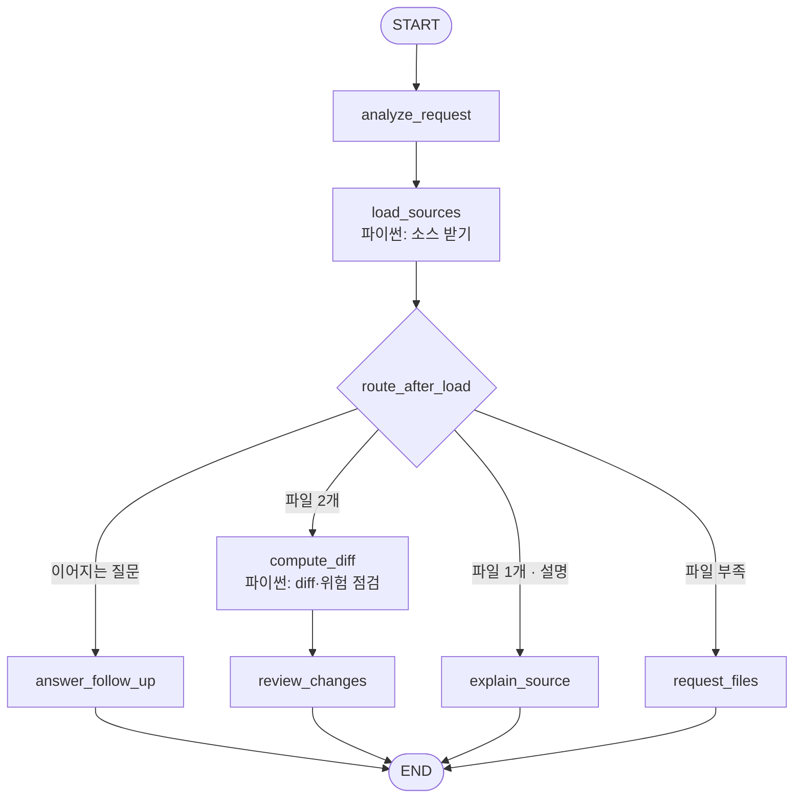

# 3조 - MES 소스 리뷰 선배봇

> 한 줄 소개: 같은 MES 소스의 수정 전/후 파일을 받아 무엇이 바뀌었는지, MES 업무에 어떤 영향이 있는지, 위험한 변경은 없는지 리뷰해 주는 에이전트 (소스 하나만 주면 무슨 일을 하는 코드인지 설명)

**예시 질문** (`teams/team3/inbox/` 의 예제 파일로 바로 돌려볼 수 있습니다)

1. LotTrackIn.cs 수정 전후 비교해줘
2. LotTrackIn_old.cs 이 소스가 무슨 일을 하는지 설명해줘
3. 소스 변경 리뷰 해줘

**주제 선정 회의**

> 조원이 실제로 모여서 주제를 정했는지 확인하는 항목입니다. 빈칸 없이 채워주세요.

| 항목 | 내용 |
|---|---|
| 회의 일시 | 2026-09-17 (목) 14:00 ~ 15:00 |
| 회의 장소 | TC동 6층 IT지원실1 회의실1 |
| 참석자 | 남경효M, 박성현M, 김기웅M, 변태형M, 송치욱M, 신호경M - 6명 중 6명 |
| 불참자 / 사유 | 없음 |
| 기록자 | 박성현M |

---

## 0. 소스 파일 넣는 법

어떤 방법으로 주든 같은 노드(`load_sources`)가 받아서 처리합니다.

| 방법 | 이렇게 하세요 | 수정 전/후 구분 |
|---|---|---|
| ① 채팅에 붙여넣기 | 코드 블록(```) 2개를 차례로 붙여넣기 | 블록 바로 앞에 "수정 전 / 수정 후 (before / after, AS-IS / TO-BE)" 를 적으면 그대로, 없으면 먼저 붙인 쪽이 수정 전 |
| ② 구분선으로 붙여넣기 | `--- 수정 전 ---` 줄 아래 코드, `--- 수정 후 ---` 줄 아래 코드 | 구분선을 따름 |
| ③ inbox 폴더 | `teams/team3/inbox/` 에 파일을 넣고 "LotTrackIn.cs 비교해줘" | 파일명 끝의 `_old`, `_bak`, `.bak`, `_before`, `_asis`, `_수정전` 이 수정 전 (`_new`, `_after`, `_tobe` 는 수정 후). 하나만 말해도 짝을 자동으로 찾습니다. 표시가 없으면 수정 시간이 오래된 쪽이 수정 전 |
| ④ 나눠 보내기 | 이번 메시지에 수정 전, 다음 메시지에 수정 후 | 이전 대화에서 코드를 다시 찾아 먼저 보낸 쪽을 수정 전으로 봅니다 |
| ⑤ 터미널 | `python teams/team3/workflow.py --before a_old.cs --after a.cs "질문"` | 옵션 그대로 |

- 사내 소스가 CP949(EUC-KR)로 저장돼 있어도 자동으로 읽습니다.
- inbox 에는 1MB 이하 파일만, 파일 이름으로만 접근합니다. (`../` 같은 경로는 막음)
- inbox 목록 확인: `python teams/team3/workflow.py --inbox`
- 공용 앱이 나중에 첨부 기능을 제공해서 `state["files"]`(또는 `attachments`)로 파일을 넘겨주면 그것도 그대로 받도록 입구를 만들어 두었습니다.
- 사내 LLM 의 입력 길이에 맞춰 workflow.py 위쪽의 `MAX_DIFF_CHARS`, `MAX_SOURCE_CHARS` 를 조절하세요.

---

## 1. LangGraph 워크플로우 설계

### 1.1 State 스키마

| 필드 | 타입 | 설명 |
|---|---|---|
| user_input | str | 이번 턴 사용자 입력 (공용 제공) |
| messages | list[dict] | 이전 대화 이력 (공용 제공) |
| answer | str | 최종 답변 (공용 제공) |
| intent | str | `"new"`(새 요청) / `"followup"`(방금 답변에 이어지는 질문) |
| task | str | `"compare"`(수정 전/후 비교) / `"explain"`(소스 하나 설명) |
| file_names | list[str] | 메시지에 나온 파일 이름 |
| focus | str \| None | 특히 봐달라고 한 관점 (성능, 예외 처리, Hold 로직 등) |
| before | dict \| None | 수정 전 소스 `{name, code, lang, origin}` |
| after | dict \| None | 수정 후 소스 (파일이 하나면 여기에 들어감) |
| source_status | str | `"pair"`(2개) / `"single"`(1개) / `"none"`(없음) |
| source_notes | list[str] | 파일을 받으면서 생긴 문제 (inbox 에 없음, 크기 초과 등) |
| diff_text | str | 행 번호가 붙은 diff (LLM 입력용) |
| diff_stats | dict | 변경 블록 수, 추가/삭제 줄 수, 생략 여부 |
| changed_funcs | list[str] | 변경이 일어난 함수 이름 |
| risk_hints | list[str] | 패턴으로 찾은 위험 의심 지점 (심각도 + 행 번호) |

### 1.2 노드 구성

| 노드 | 역할 | 읽는 필드 | 쓰는 필드 |
|---|---|---|---|
| analyze_request | (LLM) 이어지는 질문 여부, 비교/설명 구분, 파일명·중점 관점 추출 (코드는 "[코드 블록 N줄]" 로 줄여서 보냄) | user_input, messages | intent, task, file_names, focus |
| load_sources | (**LLM 없음**) 코드 블록·구분선·inbox·이전 대화에서 소스를 모아 수정 전/후 짝 맞추기, 언어 판별 | user_input, messages, task, intent, file_names | before, after, source_status, source_notes |
| compute_diff | (**LLM 없음**) 줄 단위 비교, 행 번호 diff, 변경 함수 찾기, 위험 패턴 점검 | before, after | diff_text, diff_stats, changed_funcs, risk_hints |
| review_changes | (LLM) 변경 내역, MES 업무 영향, 위험 포인트, 테스트 체크리스트 작성 | before, after, diff_*, changed_funcs, risk_hints, focus | answer |
| explain_source | (LLM) 소스 하나의 처리 흐름, 다루는 데이터, 주의할 부분 설명 | after, focus | answer |
| request_files | (LLM) 부족한 파일과 소스를 주는 방법 안내, inbox 목록 표시 | task, before, after, source_notes | answer |
| answer_follow_up | (LLM) 앞선 리뷰에 대한 추가 질문 답변 (이전 대화에서 소스를 다시 찾아 근거로 사용) | before, after, source_status, messages | answer |

### 1.3 엣지 & 조건 분기

| 출발 | 조건 | 도착 |
|---|---|---|
| START | - | analyze_request |
| analyze_request | - | load_sources |
| load_sources | intent == "followup" 이고 이전 대화가 있음 | answer_follow_up |
| load_sources | source_status == "pair" | compute_diff |
| load_sources | source_status == "single" 이고 task == "explain" | explain_source |
| load_sources | 그 외 (파일 없음, 비교인데 1개뿐) | request_files |
| compute_diff | - | review_changes |
| review_changes, explain_source, request_files, answer_follow_up | - | END |

### 1.4 워크플로우 다이어그램



### 1.5 이 구조로 설계한 이유

- **"어디가 바뀌었는지"는 코드가, "그래서 뭐가 문제인지"는 LLM 이 맡습니다.** 두 파일을 통째로 LLM 에 주고 비교시키면 바뀐 줄을 놓치거나, 바뀌지 않은 줄을 바뀌었다고 말하고, 행 번호도 틀립니다. 그래서 diff 는 파이썬(`difflib`)이 정확히 계산하고, LLM 은 행 번호가 붙은 변경 부분만 받아 리뷰합니다. 파일이 길어도 바뀐 부분만 넘기므로 사내 LLM 입력 길이 안에 들어갑니다.
- **위험 패턴은 코드가 먼저 찾고, LLM 이 확인합니다.** Hold·상태 체크 삭제, `throw` 삭제, 빈 catch, WHERE 없는 UPDATE, 트랜잭션 변경, Sleep 추가 같은 MES 에서 사고로 이어지기 쉬운 패턴을 정규식으로 먼저 찾아 "의심 목록"으로 넘깁니다. LLM 혼자서는 이런 것을 자주 놓치고, 정규식 혼자서는 오탐이 많아서 둘을 합쳤습니다.
- **파일 받기를 별도 노드로 분리했습니다.** 공용 채팅 화면의 첨부 기능에 의존하지 않도록 붙여넣기·구분선·inbox·메시지 나눠 보내기 등 여러 입구를 `load_sources` 한 곳에서 처리합니다. 입력 방식이 늘어나도 다른 노드는 고칠 필요가 없습니다.
- **비교 / 설명 / 이어지는 질문을 노드로 나눴습니다.** 비교 리뷰는 "변경 내역·영향·테스트" 가, 단일 소스 설명은 "처리 흐름·다루는 데이터" 가 중요해서 형식이 다릅니다.
- **파일이 부족하면 분석하지 않고 되묻습니다.** 비교를 요청했는데 파일이 하나뿐이면 LLM 이 상상으로 비교하지 않도록 `request_files` 로 보내 부족한 것을 알려줍니다.
- **긴 코드는 대화 기록에 그대로 보내지 않습니다.** 이전 대화와 의도 분석에는 코드를 "[코드 블록 N줄]" 로 줄여서 보내고, 코드가 필요한 노드만 정리된 형태로 받습니다.

---

## 2. 프롬프트 엔지니어링

> ⚠️ 아래 '개선 전 -> 후' 표는 설계 과정에서 예상되는 문제를 기준으로 쓴 **초안**입니다.
> 실제로 돌려보면서 나온 이상한 출력으로 '그때의 문제' 칸을 바꿔 적어주세요.

### 2.0 공통 규칙 (COMMON_RULES)

분석 노드 3개(review_changes, explain_source, answer_follow_up)의 프롬프트 뒤에 공통으로 붙는 규칙입니다. "코드 근거로만 말하기" 원칙을 한 곳에서 관리하려고 분리했습니다.

````
[공통 규칙 - 코드 근거로만 말하기]
- 주어진 코드와 diff 에 없는 함수, 테이블, 로직을 지어내지 마세요.
- 근거를 말할 때는 행 번호를 함께 적으세요. (예: "수정 후 52행", "수정 전 31행")
- 테이블, 컬럼, 상태값의 의미를 이름으로 짐작했다면 "이름으로 보아" 처럼 추정임을 밝히세요.
- 사내 업무 규칙(예: "Hold Lot 은 반드시 막아야 한다")은 단정하지 말고
  "일반적인 MES 에서는 ~ 하므로 확인이 필요합니다" 처럼 쓰세요.
- 개선 코드 예시는 꼭 필요한 부분만 5줄 이내로 짧게 보여주세요.
- 친근한 존댓말, 마크다운으로 작성합니다.
````

### 2.1 analyze_request

**최종 System Prompt** (`ANALYZE_REQUEST_SYSTEM`)

````
당신은 MES 개발팀의 코드 리뷰 접수 담당자입니다.
이전 대화와 이번 메시지를 보고 아래 항목을 채우세요.
메시지 안의 코드는 길어서 "[코드 블록 N줄]" 로 줄여서 보여줍니다.
맨 앞의 [이번 메시지에 포함된 것] 은 시스템이 붙인 정보입니다.

- intent: 이번 메시지의 성격
  - "new": 새 분석 요청. 새 코드나 새 파일명을 준 경우는 항상 "new" 입니다.
  - "followup": 방금 한 분석 결과에 대한 추가 질문
    ("2번 위험은 어떻게 고쳐?", "CheckRecipe 는 왜 추가했을까?", "테스트 케이스 더 줘")
  - 이전 대화가 없으면 항상 "new" 입니다.
- task: 원하는 분석
  - "compare": 수정 전/후 소스 비교, 변경 리뷰, 무엇이 바뀌었는지 (코드나 파일이 2개면 대부분 이것)
  - "explain": 소스 하나가 무슨 일을 하는지 설명, 분석
  - 직전에 파일을 요청받고 이번에 파일을 준 경우와 followup 이면 직전 요청의 task 를 그대로 씁니다.
- file_names: 메시지에 나온 소스 파일 이름 목록 (확장자 포함, 없으면 [])
- focus: 사용자가 특히 봐달라고 한 관점 (예: "성능", "예외 처리", "Hold 로직"), 없으면 null

반드시 아래 JSON 형식으로만 답하세요. 설명 문장을 붙이지 마세요.

{"intent": "new", "task": "compare", "file_names": [], "focus": null}
````

**설계 의도**

- 비교(compare)인지 설명(explain)인지, 이어지는 질문인지를 판정합니다.
- 코드 본문은 "[코드 블록 N줄]" 로 줄여서 보내고, 코드 개수·파일명은 시스템이 미리 세어 맨 앞에 붙여 줍니다. 수천 줄 코드를 의도 분석에 넣지 않기 위해서입니다.
- 새 코드나 파일명이 있으면 LLM 판단과 상관없이 코드에서 '새 요청' 으로 고정합니다.

**개선 전 -> 후**

| 구분 | 내용 |
|---|---|
| 개선 전 | 사용자가 원하는 작업과 파일명을 JSON 으로 뽑으세요. (코드 원문을 그대로 함께 보냄) |
| 그때의 문제 | 코드 300줄을 붙여넣자 입력이 길어져 JSON 대신 코드 설명을 출력하거나, 코드 안의 `System.Data` 같은 문자열을 파일명으로 뽑음. |
| 개선 후 | 코드를 줄여서 보내고, 코드 개수·파일명 정보를 시스템이 붙여 주도록 변경. 파일명은 코드 밖 문장에서만 찾음. |
| 달라진 점 | 의도 분석이 짧은 입력으로 안정적으로 JSON 을 반환하고, 엉뚱한 파일명을 뽑지 않음. |

### 2.2 load_sources (LLM 없음)

파이썬 노드라 프롬프트가 없습니다. 대신 처리 규칙을 적습니다.

- 받는 순서: 첨부(state) → 코드 블록 → 구분선 → 메시지의 파일명으로 inbox 읽기 → inbox 에서 같은 소스의 다른 버전(_old 등) 짝 찾기 → 부족하면 이전 대화에서 찾기
- 수정 전/후 판단: 코드 블록 앞 문장이나 파일명의 표시(수정 전/후, before/after, AS-IS/TO-BE, _old/_new) → 없으면 먼저 받은 쪽(파일은 오래된 쪽)이 수정 전
- "Hold" 안의 old 처럼 단어 일부가 잘못 걸리지 않게 앞뒤가 알파벳이 아닐 때만 인정
- 인코딩은 UTF-8 → CP949 순서로 시도, inbox 는 파일 이름만 사용(경로 조작 차단), 1MB 제한

| 구분 | 내용 |
|---|---|
| 개선 전 | LLM 에게 "메시지에서 수정 전 코드와 수정 후 코드를 나눠서 JSON 으로 돌려줘" 라고 시킴 |
| 그때의 문제 | 긴 코드를 JSON 문자열로 옮기면서 줄이 빠지거나 따옴표 이스케이프가 깨지고, 수정 전/후를 바꿔서 넣는 경우가 생김. |
| 개선 후 | 코드 추출을 정규식과 파일 읽기로 바꾸고, 전/후 판단 규칙을 코드로 명시. |
| 달라진 점 | 원본 코드가 한 글자도 바뀌지 않고 그대로 비교에 들어감. |

### 2.3 compute_diff (LLM 없음)

파이썬 노드라 프롬프트가 없습니다. 대신 처리 규칙을 적습니다.

- `difflib.SequenceMatcher` 로 줄 단위 비교, 변경 앞뒤 3줄 문맥 포함, 줄 끝 공백 차이는 무시
- 각 줄에 `기호 수정전행 수정후행 | 코드` 형식으로 행 번호를 붙여서 LLM 이 정확한 행을 인용할 수 있게 함
- 추가된 줄은 수정 후 파일, 삭제된 줄은 수정 전 파일 기준으로 감싸는 함수 이름을 찾음
- 위험 패턴: 삭제된 Hold·상태 체크 / `throw` 삭제 / 빈 catch / WHERE 없는 UPDATE·DELETE / WHERE 삭제 / 트랜잭션 변경 / null 체크 삭제 / lock 삭제 / Sleep / `SELECT *` / 하드코딩 IP·비밀번호 / 디버그 출력 / TODO / 로그 삭제
- diff 가 `MAX_DIFF_CHARS` 를 넘으면 위험 의심 지점이 있는 블록부터 넣고 나머지는 생략 표시

| 구분 | 내용 |
|---|---|
| 개선 전 | unified diff(`@@ -23,9 +25,12 @@`) 를 그대로 LLM 에 넘김 |
| 그때의 문제 | LLM 이 `@@` 헤더로 행 번호를 직접 계산하다가 "수정 후 31행" 처럼 틀린 행을 말함. Hold 체크 삭제를 단순한 '코드 정리' 로 설명하고 넘어감. |
| 개선 후 | 모든 줄에 수정 전/후 행 번호를 직접 붙이고, MES 에서 사고로 이어지기 쉬운 패턴을 자동 점검해 [자동 점검 결과] 로 함께 넘김. |
| 달라진 점 | 인용하는 행 번호가 정확해지고, Hold 체크·throw 삭제를 '높음' 위험으로 먼저 다룸. |

### 2.4 review_changes

**최종 System Prompt** (`REVIEW_CHANGES_SYSTEM`)

````
당신은 반도체 MES 개발 10년차 시니어 개발자이자 코드 리뷰어입니다.
같은 소스의 수정 전/후 비교 결과를 보고 변경 리뷰를 작성하세요.

입력 설명:
- [변경 내용] 각 줄은 "기호 수정전행 수정후행 | 코드" 형식입니다.
  '-' 는 삭제, '+' 는 추가, 공백은 변경 없는 앞뒤 문맥입니다.
- [자동 점검 결과] 는 패턴으로 찾은 의심 지점이라 오탐이 있을 수 있습니다. 코드로 확인해서 맞는 것만 쓰세요.

형식:
1. **한 줄 요약**: 이번 수정이 무엇을 바꿨는지
2. **변경 내역**: 함수별로 무엇이 어떻게 바뀌었는지 (행 번호와 함께, 3~6개 항목)
3. **MES 업무 영향**: Lot 상태·이력, 설비, 트랜잭션, 데이터 정합성 관점에서 달라지는 동작
4. **위험 포인트**: 심각도가 높은 순서로, 항목마다 `[높음/중간/낮음] 근거 행 - 문제 - 개선 제안`
   의도된 변경인지 실수인지 코드만으로 알 수 없으면 "의도 확인 필요" 라고 적으세요.
5. **테스트 체크리스트**: 배포 전에 확인할 시나리오 3~5개 (- [ ] 형식)

규칙:
- [변경 통계]에 "일부 생략" 표시가 있으면 마지막에 변경량이 많아 일부만 분석했다고 알리세요.
- [중점 관점]이 있으면 그 관점을 위험 포인트에서 가장 먼저 다루세요.
````

> 이 노드의 프롬프트 뒤에는 2.0 의 `COMMON_RULES` 가 붙습니다.

**설계 의도**

- 변경 내역 → MES 업무 영향 → 위험 포인트 → 테스트 체크리스트 순서로, 리뷰 회의에서 바로 쓸 수 있는 형식입니다.
- 자동 점검 결과는 '의심 목록' 으로만 쓰고 코드로 확인한 것만 남기게 해서 오탐을 걸러냅니다.
- 실수인지 의도인지 알 수 없는 변경은 "의도 확인 필요" 로 표시해 리뷰어가 개발자에게 물어볼 수 있게 했습니다.

**개선 전 -> 후**

| 구분 | 내용 |
|---|---|
| 개선 전 | 두 코드를 비교해서 바뀐 점을 알려주세요. |
| 그때의 문제 | "Recipe 체크 기능이 추가되었습니다" 처럼 추가된 기능만 설명하고, 같이 삭제된 Hold 체크와 `throw;` 는 언급하지 않음. 존재하지 않는 `ValidateLot()` 함수를 언급함. |
| 개선 후 | 형식에 'MES 업무 영향'·'위험 포인트(심각도 순)'·'테스트 체크리스트' 를 추가하고, 공통 규칙에 '코드에 없는 함수 금지, 행 번호 인용' 추가. |
| 달라진 점 | 삭제된 로직의 영향까지 리뷰하고, 모든 지적에 행 번호 근거가 붙음. |

### 2.5 explain_source

**최종 System Prompt** (`EXPLAIN_SOURCE_SYSTEM`)

````
당신은 반도체 MES 개발 10년차 시니어 개발자입니다.
소스 파일 하나를 받아 처음 보는 동료에게 설명하듯 분석하세요.

입력 설명:
- [소스] 각 줄 앞의 숫자는 행 번호입니다.
- [구조] 는 코드에서 자동으로 찾은 클래스·함수 목록입니다.
- [자동 점검 결과] 는 패턴으로 찾은 의심 지점이라 오탐이 있을 수 있습니다. 코드로 확인해서 맞는 것만 쓰세요.

형식:
1. **한 줄 요약**: 이 소스가 하는 일
2. **처리 흐름**: 주요 함수의 처리 순서를 단계별로 (행 번호와 함께)
3. **다루는 데이터**: 코드에 나오는 테이블·컬럼·상태값과 그 역할 (Lot, 설비, 이력 등 MES 관점)
4. **주의해서 볼 부분**: 예외 처리, 트랜잭션, 동시성, 성능 관점에서 2~4개
5. **수정할 때 팁**: 이 소스를 고칠 때 같이 확인해야 할 것 1~2개

규칙:
- [소스]가 잘렸다는 표시가 있으면 보이는 부분만 분석했다고 알리세요.
- [중점 관점]이 있으면 그 관점을 가장 자세히 다루세요.
````

> 이 노드의 프롬프트 뒤에는 2.0 의 `COMMON_RULES` 가 붙습니다.

**설계 의도**

- 처음 보는 소스를 인수인계 받을 때처럼 처리 흐름, 다루는 테이블·상태값, 주의할 부분을 정리합니다.
- 파이썬이 찾은 함수 목록([구조])을 함께 줘서 큰 파일에서도 전체 구조를 먼저 잡게 했습니다.

**개선 전 -> 후**

| 구분 | 내용 |
|---|---|
| 개선 전 | 이 소스를 설명해 주세요. |
| 그때의 문제 | 코드를 한 줄씩 번역하듯 설명해서 길기만 하고 핵심(이 코드가 Lot 상태를 RUN 으로 바꾸고 이력을 남긴다)이 잘 안 보임. |
| 개선 후 | 한 줄 요약 → 처리 흐름 → 다루는 데이터 → 주의할 부분 → 수정 팁 형식으로 고정. |
| 달라진 점 | 핵심 흐름이 먼저 나오고, 수정할 때 같이 볼 부분까지 알려줌. |

### 2.6 request_files

**최종 System Prompt** (`REQUEST_FILES_SYSTEM`)

````
당신은 친절한 MES 코드 리뷰 도우미입니다.
분석에 필요한 소스를 아직 받지 못했습니다. 무엇이 부족한지와 소스를 주는 방법을 짧게 안내하세요.

- [받은 파일]과 [확인된 문제]를 보고 무엇이 부족한지 한 줄로 알려주세요.
  (예: 수정 후 파일만 받아서 수정 전 파일이 필요함 / 말씀하신 파일명을 inbox 에서 찾지 못함)
- 소스를 주는 방법 3가지를 번호 목록으로 안내하세요.
  1. 채팅에 붙여넣기: "수정 전" 코드 블록과 "수정 후" 코드 블록을 차례로 (``` 로 감싸기)
  2. inbox 폴더에 넣고 파일명으로 요청: 예) "LotTrackIn.cs 비교해줘"
     수정 전 파일 이름 끝에 _old 를 붙여 두면 자동으로 짝을 찾습니다.
  3. 나눠서 보내기: 이번에 수정 전 코드, 다음 메시지에 수정 후 코드를 보내도 됩니다.
- [inbox 파일 목록]이 있으면 "지금 inbox 에 있는 파일" 로 최대 10개까지 보여주세요.
- 10줄 이내로 씁니다.
````

**설계 의도**

- 비교에 필요한 파일이 부족할 때 LLM 이 상상으로 비교하지 않도록 이 노드로 보냅니다.
- 무엇이 부족한지와 함께 파일을 주는 방법 3가지, inbox 에 있는 파일 목록을 보여줘서 다음 턴에 바로 요청할 수 있게 합니다.

**개선 전 -> 후**

| 구분 | 내용 |
|---|---|
| 개선 전 | 파일이 없으면 파일을 달라고 하세요. |
| 그때의 문제 | "파일을 업로드해 주세요" 라고만 안내해서 사용자가 어떤 방법으로 주면 되는지 모름. |
| 개선 후 | 실제로 가능한 방법(붙여넣기 / inbox + 파일명 / 나눠 보내기)과 inbox 목록을 안내하도록 변경. |
| 달라진 점 | 사용자가 안내대로 inbox 파일명을 말해 다음 턴에 바로 비교가 진행됨. |

### 2.7 answer_follow_up

**최종 System Prompt** (`FOLLOW_UP_SYSTEM`)

````
당신은 방금 소스 분석 결과를 알려준 시니어 MES 개발자입니다.
이전 대화에 이어서 사용자의 추가 질문에 답하세요.

- [참고 자료]의 코드와 diff 를 근거로 답합니다.
- 앞서 말한 내용을 처음부터 반복하지 말고, 새로 물은 부분에 집중합니다.
- 사용자가 수정 코드를 직접 요청한 경우에는 바뀌는 부분을 15줄 이내로 보여줘도 됩니다.
- 코드를 빼고 7문장 이내로 씁니다.
````

> 이 노드의 프롬프트 뒤에는 2.0 의 `COMMON_RULES` 가 붙습니다.

**설계 의도**

- "Hold 체크 지운 거 어떻게 고쳐?" 같은 이어지는 질문에, 이전 대화에서 소스를 다시 찾아 diff 를 근거로 붙여 답합니다.
- 수정 코드를 직접 요청한 경우만 코드 길이 제한을 늘려줍니다.

**개선 전 -> 후**

| 구분 | 내용 |
|---|---|
| 개선 전 | 사용자의 추가 질문에 답하세요. (이전 대화만 참고) |
| 그때의 문제 | 이전 대화에는 코드가 "[코드 블록 N줄]" 로 줄어 있어서, 고친 코드를 요청하자 원래 코드와 다른 변수명으로 코드를 지어냄. |
| 개선 후 | 이전 대화의 소스를 다시 찾아 [참고 자료] 로 함께 넘기고, 코드 근거 규칙 적용. |
| 달라진 점 | 원래 코드의 변수명·테이블명 그대로 수정 코드를 제시함. |

---

## 3. 실행 결과 & 회고

### 3.1 실행 예시

> 맨 위에 적은 **예시 질문 3개가 각각 정상 동작하는 화면을 캡처해서** 아래에 붙여주세요.
> **`teams/team3/screenshots/` 폴더**에 `case1.png`, `case2.png`, `case3.png` 로 저장하세요.
> 답변과 함께 **하단의 실행 노드 배지가 보이게** 찍어주세요.
> 캡처 없이 글로만 적은 것은 실행 확인으로 인정되지 않습니다.

**케이스 1** - 수정 전/후 비교 리뷰
| 입력 | 출력 (요약) | 실행 노드 |
|---|---|---|
| LotTrackIn.cs 수정 전후 비교해줘 | (실행 후 요약 작성) | analyze_request → load_sources → compute_diff → review_changes |


**케이스 2** - 소스 하나 설명
| 입력 | 출력 (요약) | 실행 노드 |
|---|---|---|
| LotTrackIn_old.cs 이 소스가 무슨 일을 하는지 설명해줘 | (실행 후 요약 작성) | analyze_request → load_sources → explain_source |


**케이스 3** - 파일이 없을 때 안내
| 입력 | 출력 (요약) | 실행 노드 |
|---|---|---|
| 소스 변경 리뷰 해줘 | (실행 후 요약 작성) | analyze_request → load_sources → request_files |


> 예제 파일(`inbox/LotTrackIn_old.cs` → `inbox/LotTrackIn.cs`)에는 일부러 넣은 문제가 있습니다.
> 리뷰가 아래를 찾아내는지 확인해 보세요.
> - Recipe 체크를 추가하면서 **Hold Lot 체크를 지움** (Hold 된 Lot 이 Track-In 될 수 있음)
> - catch 에서 **`throw;` 와 에러 로그를 지움** (실패해도 호출한 쪽은 성공으로 알게 됨)
> - **`Thread.Sleep(500)`** 을 트랜잭션 안에 추가 (DB 잠금 시간 증가)
> - `SELECT *`, `Console.WriteLine` 디버그 출력, TODO 주석
>
> 추가로 확인해 보면 좋은 흐름 (캡처는 선택)
> - 케이스 1 다음에 "Hold 체크 지운 거 어떻게 고쳐?" → answer_follow_up
> - "수정 전 코드야" + 코드 블록 → request_files, 이어서 "수정 후" + 코드 블록 → compute_diff → review_changes
> - "Foo.cs 비교해줘" (없는 파일) → request_files 가 inbox 목록을 보여주는지

### 3.2 잘 된 점 / 한계 / 개선 아이디어

- **잘 된 점**: diff 와 위험 패턴 점검을 코드로 분리해서 행 번호가 정확하고, 긴 소스도 바뀐 부분만 LLM 에 넘깁니다. 붙여넣기, inbox, 나눠 보내기 등 여러 방식으로 파일을 받을 수 있습니다.
- **한계**: 위험 패턴이 정규식 기반이라 오탐·미탐이 있습니다. 함수 찾기도 줄 단위 패턴이라 언어에 따라 정확도가 다릅니다. 파일 단위 비교라 다른 파일에 미치는 영향(호출하는 쪽)은 보지 못합니다. inbox 방식은 서버 폴더에 파일을 직접 넣어야 합니다.
- **다음에 개선한다면**: 사내 Git/SVN 에서 커밋 번호로 수정 전/후를 자동으로 가져오기, 여러 파일(커밋 단위) 리뷰, 사내 코딩 규칙을 위험 패턴에 추가, 함수 호출 관계를 보고 영향 범위 분석.

### 3.3 배운 점

- 정답이 정해진 작업(비교, 행 번호, 패턴 찾기)은 코드 노드에 맡기고 LLM 은 해석만 맡기면 환각이 크게 줄었습니다.
- 긴 입력은 노드마다 필요한 만큼만 잘라서 넘기는 것이 사내 LLM 의 입력 길이 제한 안에서 품질을 지키는 방법이었습니다.
- (조원들이 실제로 느낀 점을 추가해 주세요)

## 산출물 정리 회의

> 문서를 어떻게 마무리했는지 남기는 항목입니다. 빈칸 없이 채워주세요.

| 항목 | 내용 |
|---|---|
| 회의 일시 | 2026-10-19 (월) 14:00 ~ 15:00 |
| 회의 장소 | TC동 6층 IT지원실1 회의실1 |
| 참석자 | 남경효M, 박성현M, 김기웅M, 변태형M, 송치욱M, 신호경M - 6명 중 6명 |
| 불참자 / 사유 | 없음 |
| 기록자 | 박성현M |

**어떻게 진행했는지**

(회의 후 실제 내용으로 수정해 주세요. 아래는 초안입니다.)

- 각자 맡은 노드(파일 받기·diff / 리뷰 / 설명 / 안내)의 역할과 프롬프트 개선 과정을 설명
- 예제 소스와 실제 업무 소스로 예시 질문 3개를 함께 돌려보며 실행 노드 배지가 보이게 캡처
- mermaid 다이어그램과 workflow.py 의 노드·엣지를 대조해 일치 여부 확인
- 한계와 배운 점을 정리하고 README 최종본 확정
